<!-- Images under profile/ are generated daily by .github/workflows/update-profile.yml -->

<b>English</b> · <a href="README.pt-BR.md">Português</a>

## 👋 About me

- 💼 **Software Engineer**, mostly backend: PHP with **Magento / Adobe Commerce** and **Symfony**, plus JavaScript and React on the front.
- 🎮 **Side project:** open-source [MelonLoader mods for Idle Slayer](https://github.com/ygorkaua/Mods-for-Idle-Slayer) released on Nexus Mods.
- 🏠 **Home automation tinkerer:** running Home Assistant and hacking on [tuya-local](https://github.com/ygorkaua/tuya-local).
- 🎓 B.Sc. in Computer Science, Universidade Paulista (UNIP).
- 💬 Ask me about Magento modules, e-commerce backends and PHP architecture.

## 🛠️ Tech stack

<table>
  <tr>
    <td><b>Daily work</b></td>
    <td>
       
      
    </td>
  </tr>
  <tr>
    <td><b>Also use</b></td>
    <td></td>
  </tr>
  <tr>
    <td><b>For fun</b></td>
    <td></td>
  </tr>
</table>

## 🚀 Featured projects

  
  
  
  

## 📊 GitHub stats

  
  

  <picture>
    <source media="(prefers-color-scheme: dark)" srcset="./profile/snake-dark.svg" />
    <source media="(prefers-color-scheme: light)" srcset="./profile/snake.svg" />
    
  </picture>

## 📫 Connect

  
  
  

